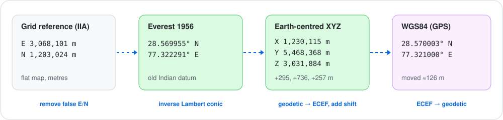
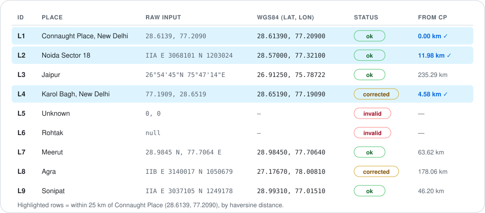
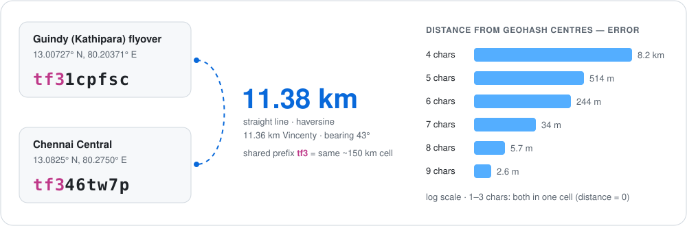

<p align="center">
  
</p>

# Location Normalisation — Technical Assessment

> **Priyadarshini R**
> B.Tech Artificial Intelligence and Data Science · 3rd year
> Chennai Institute of Technology, Chennai
>
> **Stack:** Python 3.11 · Jupyter · pandas · matplotlib. All geodesy is written from first principles, with no projection library.

---

## The problem

Field reports carry locations in **five different formats**: decimal degrees, degrees‑minutes‑seconds, hemisphere letters, **Indian Grid** eastings/northings, and missing or placeholder values. The task:

- **Part A:** convert every location to **WGS84** decimal latitude/longitude and flag anything invalid or wrong.
- **Part B:** list the reports within **25 km of Connaught Place (28.6139, 77.2090)** and explain the distance method.
- **Part C:** choose an **Elasticsearch** field type and query, and decide whether to convert at load time or at query time.
- **Extension (my addition):** encode locations as **geohashes**, and measure the **Guindy flyover → Chennai Central** distance.

---

## Proposed solution

<p align="center"></p>

<details>
<summary><b>Step 1 · Ingest</b>: read the Elasticsearch response</summary>

The input file is an Elasticsearch search response, so each record is read from `hits.hits[]._source`. The response's `hits.total.value` (9) is checked against the number of records actually read.
</details>

<details>
<summary><b>Step 2 · Detect format</b>: one regular expression per format</summary>

| Format | Example | Notes |
|---|---|---|
| `grid` | `IIA E 3068101 N 1203024` | zone, then easting/northing in metres |
| `dms` | `26°54'45"N 75°47'14"E` | `d + m/60 + s/3600`, negative for S/W |
| `hemisphere` | `28.9845 N, 77.7064 E` | sign taken from the letter |
| `decimal_pair` | `28.6139, 77.2090` | order is **not trusted**; checked in Step 4 |
| `missing` | `null` | kept, flagged invalid |

The patterns are tried from most specific to least specific, so a grid reference is never mistaken for a pair of numbers.
</details>

<details>
<summary><b>Step 3 · Convert</b>: Indian Grid → WGS84 in two stages</summary>

<p align="center"></p>

**3a. Inverse Lambert Conformal Conic (1SP)** on the Everest 1956 ellipsoid (a = 6 377 301.243 m, 1/f = 300.8017; φ₀ = 26°N; λ₀ = 74°E for IIA, 90°E for IIB; k₀ = 0.99878641; FE = 2 743 196.4 m; FN = 914 398.8 m):

$$r' = \sqrt{(E-FE)^2 + \big(r_0-(N-FN)\big)^2},\quad \theta' = \operatorname{atan2}\big(E-FE,\ r_0-(N-FN)\big),\quad \lambda = \frac{\theta'}{n} + \lambda_0$$

$$t' = \left(\frac{r'}{a k_0 F}\right)^{1/n},\qquad \varphi_{i+1} = \frac{\pi}{2} - 2\arctan\!\left[t'\left(\frac{1-e\sin\varphi_i}{1+e\sin\varphi_i}\right)^{e/2}\right]$$

Here $n = \sin\varphi_0$, $F = m_0 / (n\,t_0^{\,n})$ and $r_0 = aFt_0^{\,n}k_0$. The latitude equation is repeated until φ changes by less than $10^{-12}$ rad.

**3b. Datum shift** (3‑parameter geocentric translation, Indian → WGS84: ΔX = +295 m, ΔY = +736 m, ΔZ = +257 m):

$$X = \nu\cos\varphi\cos\lambda,\quad Y = \nu\cos\varphi\sin\lambda,\quad Z = \nu(1-e^2)\sin\varphi,\qquad \nu = \frac{a}{\sqrt{1-e^2\sin^2\varphi}}$$

Add the shift, then convert XYZ back to latitude/longitude on WGS84 by repeating the latitude calculation until it settles. In this data the shift moves each point by **≈120–350 m**.

**Verification:** grid origin → exactly (26°N, λ₀); grid → lat/lon → grid round trip < 0.00001 mm; full WGS84 round trip < 0.00001 mm.
</details>

<details>
<summary><b>Step 4 · Validate &amp; flag</b>: a coordinate can be well-formed and still wrong</summary>

| # | Rule | Catches |
|---|---|---|
| 1 | Range: \|lat\| ≤ 90, \|lon\| ≤ 180 | impossible values |
| 2 | `(0, 0)` "Null Island" placeholder | **L5** |
| 3 | Outside India but **inside when swapped** → swap | **L4** |
| 4 | India bounding box (6–37.5°N, 68–97.5°E) | gross errors |
| 5 | More than 15 km from the named place → try the **other grid zone** | **L8** |

Rule 5 matters because L8 converted as zone IIB lands at about 94°E. That is still inside India (Assam), so only checking it against the expected location catches the error.
</details>

<details>
<summary><b>Step 5 · Load &amp; query</b>: Elasticsearch</summary>

Each record is stored as a `geo_point`, together with the original string, the detected format, the zone, a quality status and notes. Records with no valid location are still indexed, but **without** a `geo_point`, so they can never match a distance query by accident.
</details>

---

## Part A: Results

<p align="center"></p>

| ID | Flag | Reason |
|---|---|---|
| **L4** Karol Bagh | 🟡 corrected | Written as `lon, lat`. Read as given it would sit at latitude 77°, in the Arctic. Swapped. |
| **L5** Unknown | 🔴 invalid | `(0, 0)` is a placeholder (Gulf of Guinea), not a real location. |
| **L6** Rohtak | 🔴 invalid | No location supplied. The record is kept, and no coordinates are guessed. |
| **L8** Agra | 🟡 corrected | Labelled zone **IIB**, which places it about 1,600 km east in Assam. Read as **IIA** it matches Agra to within 1 m, so the zone label is wrong. |

## Part B: Within 25 km of Connaught Place

| ID | Place | Distance |
|---|---|---|
| L1 | Connaught Place, New Delhi | **0.00 km** |
| L4 | Karol Bagh, New Delhi *(after the axis fix)* | **4.58 km** |
| L2 | Noida Sector 18 | **11.98 km** |

**Method:** great‑circle distance by the **haversine** formula ($R = 6371.0088$ km):

$$a = \sin^2\!\tfrac{\Delta\varphi}{2} + \cos\varphi_1\cos\varphi_2\sin^2\!\tfrac{\Delta\lambda}{2},\qquad d = 2R\arcsin\sqrt{a}$$

This is cross‑checked against **Vincenty's** ellipsoidal formula on WGS84. They differ by at most about 0.25%, and the nearest point outside the radius (Sonipat, 46 km) is far from the boundary. A straight‑line distance on raw degrees would be wrong, because one degree of longitude is only about 97.7 km at 28.6°N.

## Part C: Elasticsearch

<details open>
<summary><b>Mapping and query</b></summary>

```json
PUT /locations_clean
{ "mappings": { "properties": {
    "id":              { "type": "keyword" },
    "place":           { "type": "text", "fields": { "raw": { "type": "keyword" } } },
    "location":        { "type": "geo_point" },
    "location_raw":    { "type": "keyword" },
    "location_format": { "type": "keyword" },
    "grid_zone":       { "type": "keyword" },
    "location_status": { "type": "keyword" },
    "location_notes":  { "type": "text" } } } }
```

```json
GET /locations_clean/_search
{
  "query": { "bool": { "filter": [
    { "geo_distance": { "distance": "25km", "location": { "lat": 28.6139, "lon": 77.2090 } } }
  ] } },
  "sort": [ { "_geo_distance": { "location": { "lat": 28.6139, "lon": 77.2090 },
                                 "order": "asc", "unit": "km", "distance_type": "arc" } } ]
}
```
</details>

**Convert at load time, not query time.**

1. `geo_distance` can only search `geo_point` fields, so raw grid strings can't be searched at all.
2. The conversion runs once per record instead of on every query.
3. Every query and client sees the same coordinates.
4. Bad data is caught and flagged when it arrives, not silently dropped from results.
5. Nothing is lost: the original string is stored alongside, so the data can be **reindexed** if the conversion method is ever improved.

---

## Extension: Geohash and Guindy flyover → Chennai Central

<p align="center"></p>

A geohash repeatedly halves longitude and latitude in turn, then writes the bits **5 at a time in base‑32**. Each character makes the cell 32 times smaller: 5 characters ≈ 4.9 km, 7 ≈ 150 m, 9 ≈ 5 m. Encode, decode and neighbours are implemented by hand and tested against Wikipedia's published examples and 2,000 random points.

| | Coordinates | Geohash |
|---|---|---|
| Guindy (Kathipara) flyover | 13.00727°N, 80.20371°E | `tf31cpfsc` |
| Chennai Central | 13.0825°N, 80.2750°E | `tf346tw7p` |
| **Straight‑line distance** | **11.38 km** haversine · 11.36 km Vincenty · bearing 43° (north‑east) | shared prefix `tf3` |

<details>
<summary><b>Findings from the experiment</b></summary>

- **Geohash groups points; it doesn't measure distance.** Two points 0.22 m apart on either side of a cell edge share only `tf`, while Guindy and Central, 11.4 km apart, share `tf3`.
- **Distance from geohash cell centres** is only reliable from about 7 characters (error ≈ 34 m).
- **Proximity search = coarse geohash filter, then exact distance.** With a 12 km radius Central is a match. With 10 km it passes the geohash filter but the exact 11.38 km rejects it.
- **The choice of reference points moves the answer more than the formula does.** Other published coordinates for the two places give 9.8–11.4 km.
- This is the straight‑line distance. The road distance (via Anna Salai) is longer and needs a road network.
</details>

---

## Repository structure

```
Location_Normalisation/
├── README.md                      ← this file
├── assets/                        ← SVG figures used in this README
├── Location_Normalisation.json    ← input (Elasticsearch search response)
├── Location_Normalisation.ipynb   ← Parts A, B, C: maths, code, checks, map
├── locations_clean.csv            ← cleaned output (written by the notebook)
└── Geohash_Distance.ipynb         ← geohash + Guindy → Central experiment
```

## How to run

```bash
pip install notebook pandas matplotlib
jupyter notebook
```

Open `Location_Normalisation.ipynb` and run all cells. It writes `locations_clean.csv`. Then open and run `Geohash_Distance.ipynb`.

## Verification summary

| Check | Result |
|---|---|
| Grid origin → (26°N, λ₀) | exact to 10⁻¹² ° |
| Projection and full datum round trips | < 0.00001 mm |
| Haversine vs Vincenty | ≤ 0.25% |
| Geohash published examples (`u4pruydqqvj`, `ezs42`) | pass |
| Geohash random-point tests (2,000 points × 12 lengths) | pass |

## Limitations

- The 3‑parameter datum shift is a regional average, accurate to tens of metres. That is fine for a 25 km search, but not for surveying.
- The place‑name check uses approximate city centres. It catches errors of kilometres, not metres.
- Reports carry no height, so h = 0 is assumed. The effect on horizontal position is negligible.

---

<p align="center"><sub>Prepared by <b>Priyadarshini R</b> · B.Tech Artificial Intelligence and Data Science, 3rd year · Chennai Institute of Technology</sub></p>
